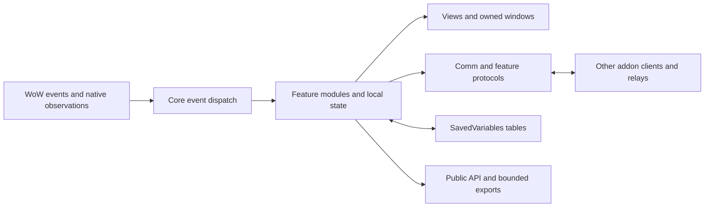
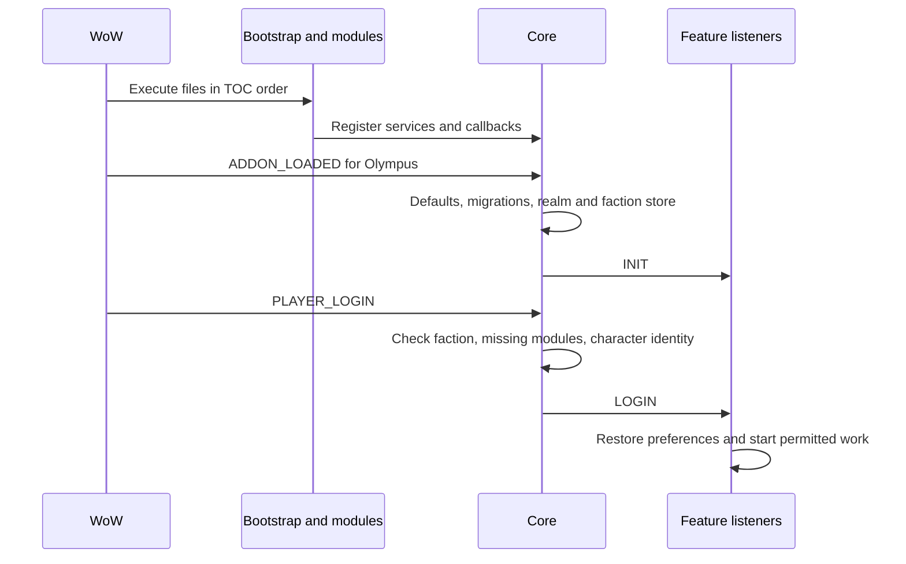

# Architecture and startup

[Documentation index](../README.md) · [Complete module map](module-map.md)

## The application in one view

Olympus is an event-driven application inside WoW's Lua runtime. Each player runs an independent copy with local storage. Clients exchange selected observations and actions through in-game messaging; there is no central application database that every client queries.

An observation, a network claim and a user action are different inputs. For example, opening an invite command is a local UI action; it is not evidence that the invite was sent or that someone joined. A received census report is a peer's observation, not direct access to another guild's roster.

## Three packaged addons

| Package | Loading and responsibility | Persistent globals |
| --- | --- | --- |
| [Olympus](../../Olympus/Olympus.toc) | Main addon: shared services, census, features, base UI and Arena domain logic | `OlympusDB`, `OlympusRecordDB` |
| [Olympus_Arena](../../Olympus_Arena/Olympus_Arena.toc) | Depends on Olympus; load-on-demand Arena screens and game boards | `OlympusArenaDB` |
| [OlympusSiteAggregate](../../OlympusSiteAggregate/OlympusSiteAggregate.toc) | Depends on Olympus; deliberate own-guild website aggregate export | `OlympusSiteAggregate` |

The TOCs are the authoritative load lists and supported-interface declarations. The package script removes the wager-only files listed in [bets-only.txt](../../scripts/bets-only.txt), so a source checkout and an installed ZIP do not contain exactly the same modules. See [Arena](arena-and-records.md).

Other repository areas are `tests/` for the offline model and regressions, `scripts/` for validation and packaging, `media/` for editable art sources, and `.github/workflows/` for CI. `dist/` is generated output, not runtime source. A local directory left by an experiment is not a shipped dependency merely because it exists on one developer's disk.

## Shared namespace and module ownership

Main-addon files normally begin with `local ADDON, ns = ...` or `local _, ns = ...`. WoW supplies the addon name and its private namespace. Modules attach services such as `ns.Data`, `ns.Recruit`, `ns.UI` and `ns.Comm` to that table. Local variables hold implementation details and session state.

This is not a conventional package-import graph. Top-level statements execute in TOC order. A module may register a callback before the component it will later call has loaded; that is safe only if the callback runs after the dependency exists. Moving a file or introducing a top-level dependency therefore needs more care than adding a runtime call.

The Arena addon receives the host namespace through a deliberately short-lived handoff during `Arena.LoadUI()`. [Handoff.lua](../../Olympus_Arena/Handoff.lua) consumes and clears the handoff, checks the module version, and supplies `own.host` to its files. Loading that addon by an unrelated route is not equivalent to using the supported loader.

## Startup sequence

[Bootstrap.lua](../../Olympus/Bootstrap.lua) installs early error capture where allowed and prepares the world-map dependency for bundled map libraries. Locale files load before most services. [Core.lua](../../Olympus/Core.lua) initializes storage, identity, compatibility helpers, event dispatch and timers. Gamepad policy and diagnostics load early enough to serve the feature modules.

On `ADDON_LOADED`, Core assigns `ns.db` and `ns.rdb` before firing `INIT`. On `PLAYER_LOGIN`, it checks the faction, identifies missing modules, sets `ns.me`, and fires `LOGIN`. Code that needs a character identity must not assume it exists during file evaluation.

Core also provides stand-ins for some not-yet-loaded modules. These support incomplete installations and update/restart handling; they are not substitutes for adding the real file to the TOC. A restart may be required when an update changes the file list.

## Two event buses and timer ownership

| Mechanism | Meaning | Example |
| --- | --- | --- |
| `ns.RegisterEvent(event, fn)` | Subscribe through Core to a native game event | Guild roster or incoming whisper |
| `ns.On(topic, fn)` / `ns.Fire(topic, ...)` | Subscribe/publish an internal application event | `INIT`, `LOGIN`, `DATA_CHANGED`, `RECRUIT_CHANGED` |
| `ns.After(seconds, where, fn)` | Delayed callback wrapped by `SafeCall` | Retry a deferred JOIN popup |
| `ns.Every(seconds, where, fn)` | Cancelable recurring work with a spread-out startup | Periodic roster or feature maintenance |

`SafeCall` contains callback errors; it does not grant permission to invoke a protected game function. Core drops chat events with secret values before feature handlers inspect them. Timer owners must still verify current permissions and session state when their callback executes.

Not all updates redraw immediately. Data changes can be coalesced, and modules cache derived results by revision. Avoid introducing a full census recomputation or a large UI rebuild into every incoming-message callback.

## How to trace a feature

Find its TOC entry, namespace assignment, event registrations and `INIT`/`LOGIN` listeners. Then follow its storage references, outgoing message registrations, receiver validation and view builder. Finally inspect its tests. The [feature map](features.md) provides the starting files; the [development guide](development.md) explains validation.
