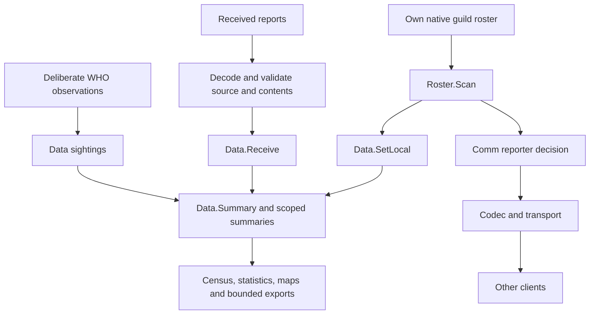

# Data and census

[Documentation index](../README.md) · [Networking](network-and-trust.md)

## Storage model

WoW restores and writes SavedVariables for the addon. Runtime code mutates Lua tables; it does not continuously write a database file. A normal logout or reload persists the saved globals. In-memory request queues, transport jobs and UI handles have different lifetimes and must not be treated as durable state.

| State | Owner and scope | Engineering consequence |
| --- | --- | --- |
| `OlympusDB` / `ns.db` | Account-level settings, diagnostic history and roots of scoped stores | Do not put guild-private state at account scope accidentally |
| `ns.rdb` | Current realm-group/faction store selected by Core | Resolve scope before reading census, roles or feature books |
| `ns.rdb.guilds` | Retained guild census reports | Values can be stale, disputed or incomplete |
| `ns.rdb.censusHistory` | Locally retained census history | A graph represents what this client observed |
| `OlympusRecordDB` | Opt-in local witness recording | Separate from the shared game-results system |
| `OlympusArenaDB` | Arena heavy data attached when its UI addon loads | Use Arena's store accessors rather than guessing layout |
| `OlympusSiteAggregate` | Deliberately prepared, masked website export | It is cleared across session boundaries; not a general backup |
| Local module tables | Current roster cache, pending requests, peers, timers and dialogs | Rebuild or invalidate when the session/guild changes |

[Core.lua](../../Olympus/Core.lua) selects the realm group and faction store. Alliance and Horde data are separated; linked realms can share a group. This is distinct from a layer, which is a copy of an area within a realm. Character preferences may be keyed further by character and guild inside that store. Do not infer storage scope from a UI tab's name.

SavedVariables are editable local data. Their existence is not proof that a payment, role grant or remote observation is genuine. Feature owners decide which stored facts must be revalidated.

## Where census information comes from

[Roster.lua](../../Olympus/Roster.lua) reads the current player's own guild roster. It builds the local report and retains member details needed by local features. `RankOf`, `MyRank`, `IsOfficer` and `Fresh` are important to authorization paths. A fresh local roster is stronger evidence for this guild than a cross-guild report.

[Comm.lua](../../Olympus/Comm.lua) elects reporters and handles propagation. [Codec.lua](../../Olympus/Codec.lua) encodes and decodes compact reports. [Data.lua](../../Olympus/Data.lua) retains accepted reports, records source/evidence, handles disputes and derives the summaries shown to the player. It also contains cross-group, global and portable census paths; these are not permission to flatten every realm into the current local store.

[Who.lua](../../Olympus/Who.lua) owns deliberate `/who` searches shared by recruiting and census refresh. A WHO result is a sighting of online characters, not a complete guild roster. Searches obey client input requirements, pending-query state and cooldowns. A new feature should use this owner rather than issuing competing searches.

There is no Blizzard web-API census fetch or mandatory external census companion in this version. Optional export/integration code is described separately in [Integrations](integrations.md).

## Freshness and interpretation

Current `Data` constants distinguish three ages: `FRESH` is 15 minutes, `TOTAL_KEEP` is 24 hours, and `KEEP` is seven days. An old row can remain visible while its online population no longer contributes to live totals. Retention, freshness and trust are different questions; consult the specific aggregate function rather than adding every retained row yourself.

A newer count-only global snapshot can supersede a detailed guild report's totals.
`Data.Summary` keeps valid same-scope roster details beside that row as `rosterDetails`,
with `rosterObserved` and `rosterFresh`. The aggregate's `g` remains count-only.
`Views` makes presentation copies to show the GM, Captains and rank names/counts without
mutating either report or granting the aggregate permission authority. The directory's
original age controls presence: a newer total cannot make an old online claim current.
Names may remain for seven days; expired, future-dated, foreign-ruleset or foreign-faction
details cannot fill a missing directory. A count-only client that never received a detailed
report still shows “not reported yet”; WHO cannot reveal guild ranks.

The report store is bounded (`MAX_GUILDS` is currently 300). Other safeguards include source claims, corroborating observations, disputes, distribution validation and scope checks. These make bad input harder to accept; they do not turn a distributed client census into a server-certified count.

Counts also have different meanings:

- **Characters:** guild membership represented by the accepted reports.
- **Online:** recent observations, with freshness rules applied.
- **People/linked alts:** estimates based on the application's identity/link evidence, not a Blizzard account-directory query.
- **Addon users:** observed addon participation, not every installed copy across all machines.
- **Sanitized census:** additional filtering and agreement rules from [CensusClean.lua](../../Olympus/CensusClean.lua).

[CensusStats.lua](../../Olympus/CensusStats.lua) turns these into explanatory pages and history views. The older [statistics reference](../CENSUS-STATS.md) describes the calculation rules and export fields; some branch-history commentary there is historical.

## Change propagation

Use the Data mutation functions instead of directly editing `ns.rdb.guilds`. They maintain revisions, notifications and the evidence other modules depend on. `Data.ChangedSoon` coalesces changes; `ChangedNow` handles cases needing immediate notification. Consumers should listen for the relevant event and cache by the owner's revision where provided.

When adding a stored field, identify its owner, scope, migration, maximum size, expiry and invalidation conditions. When adding a count, document whether unknown values are omitted, estimated or represented as zero. An unknown roster or unobserved payment must not silently become an authoritative negative result.
