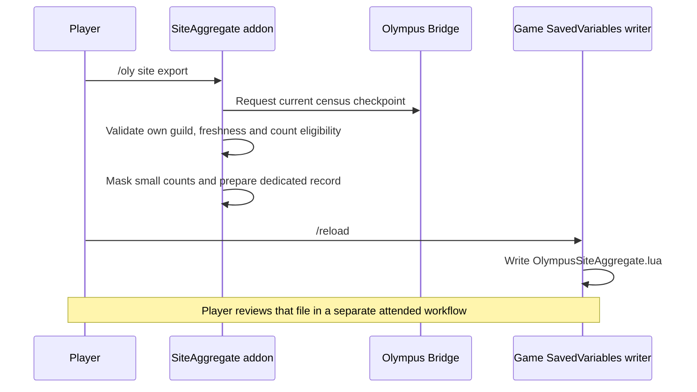

# Public integrations and deliberate exports

[Documentation home](../README.md) · [Public API reference](../API.md)

The normal addon runs entirely in game. Its integration surfaces let other installed addons or deliberate export workflows consume selected information. These surfaces have different permissions and data contracts; none is permission to expose the whole SavedVariables database.

## Public addon API

[API.lua](../../Olympus/API.lua) exposes `OlympusAPI`. An integration registers and uses the returned handle, subject to the documented permissions, limits and player consent. Use [API.md](../API.md) for exact methods and return shapes.

The API includes bounded reads and permitted requests or owned presentation features. It is not a stable promise about internal `ns` services or raw database fields. Registration does not exempt a caller from combat, input-mode, role or consent rules. A permission can stop being valid after a handle was obtained, so action-time checks remain necessary.

## Bridge contracts

[Bridge.lua](../../Olympus/Bridge.lua) exposes `OlympusBridge`, including a versioned census checkpoint and registered sections. [BridgeSections.lua](../../Olympus/BridgeSections.lua), [BridgePeople.lua](../../Olympus/BridgePeople.lua) and [BridgeAffairs.lua](../../Olympus/BridgeAffairs.lua) assemble projections from feature-owned data.

These projections are built field by field. Adding a field to an internal row must not automatically make it part of an external contract. Sections have their own audience, consent, membership and size rules; a failing section can be unavailable without exporting the raw store as a fallback.

The census checkpoint, section exports, council helpers, chat observers and recorders are different interfaces. Do not assume every Bridge endpoint inherits the census checkpoint's masking or that every endpoint has identical permissions. Follow the exact method's implementation and tests.

## Website aggregate addon

[OlympusSiteAggregate](../../OlympusSiteAggregate/SiteAggregate.lua) is the bundled, deliberate exporter documented in [SITE-AGGREGATE.md](../SITE-AGGREGATE.md). It writes a dedicated SavedVariables record; it does not upload it.

Eligibility is deliberately narrow: the current Alliance guild must match Olympus, OLYMPUS PRIME, or Olympus I through X (names are normalized without regard to case). The checkpoint must be current on the game server clock, and the selected own-guild native roster observation must be fresh and eligible. A foreign peer report is not substituted for an unavailable own-guild export.

Small positive counts below five are masked, with additional online masking when a small offline remainder would otherwise be revealed. Zero online can remain zero. The record does not contain member names, GUIDs, notes or keys. The schema's producer identifier is independently versioned: the current `1.3.2-site.1` contract marker is not the addon's TOC version. Do not update one simply to match the other.

`/oly site export` prepares the next write; `/olysite export` is a compatibility alias. After `/reload`, use the dedicated file while the game remains open: the next session clears the in-memory export, so another reload/logout empties the file. A guild change invalidates a prepared export. `/oly site clear` withdraws it and a reload writes the cleared state. The detailed schema and parser requirements live in [SITE-AGGREGATE.md](../SITE-AGGREGATE.md).

## Optional and inactive paths

| Component | Current role |
| --- | --- |
| [LinkLoader.lua](../../Olympus/LinkLoader.lua) | Loader for separately distributed `Olympus_Link`; it is not required for normal census or recruiting. |
| Bridge consumer / companion tooling | May consume supported contracts in a separate workflow; not an automatically installed or launched desktop dependency. |
| [ArmyExport.lua](../../Olympus/ArmyExport.lua) | Attended aggregate/QR prototype with `ACTIVATION_ENABLED = false`; source presence does not activate it. |
| Former web-API census experiment | Not part of the current census runtime. The addon uses game observations and peer reports. |

The standard public package contains Olympus, Olympus_Arena and OlympusSiteAggregate. Packaging can optionally include a separately supplied, clean and matching Olympus_Link checkout through `OLY_LINK_REPO`; it does not download that private addon automatically. See [package.sh](../../scripts/package.sh).

## Adding an integration

Choose the narrowest existing contract. Define the intended reader, consent, scope, freshness, size limits and unavailable state before adding fields. Return a bounded projection rather than a mutable internal table. Test denied access, stale or missing data and scope changes as well as a successful call. Any new interaction with native game UI also needs the [gamepad integration workflow](ui-and-gamepad.md).
