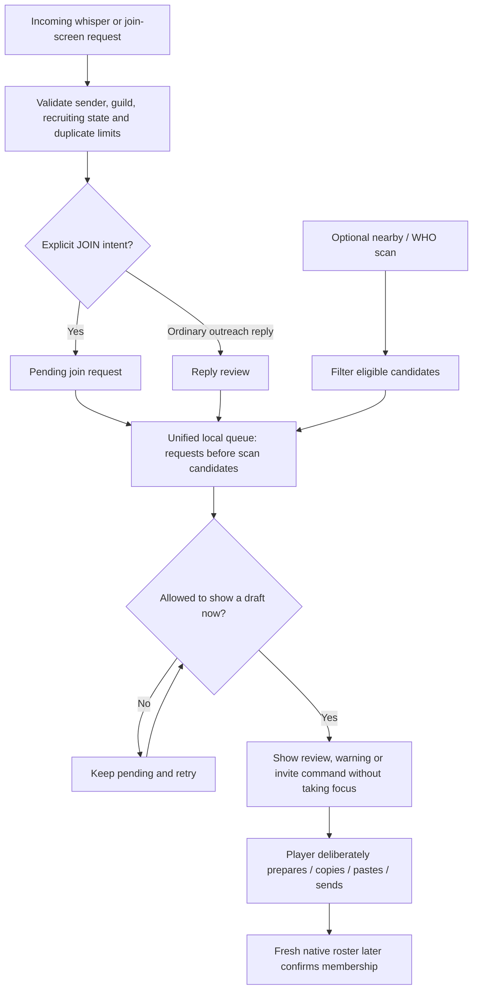

# Recruiting: from a request to a confirmed join

[Documentation home](../README.md) · [Player behavior and acceptance checks](../RECRUIT-QUEUE.md)

Church recruiting belongs to the player who starts it. Incoming JOIN requests and optional scan candidates share a queue. The addon prepares commands; the player sends the invite using copy/paste/Enter or the game's invitation controls. A fresh native guild roster confirms the result.

## Ownership

| File | Owns |
| --- | --- |
| [Recruit.lua](../../Olympus/Recruit.lua) | Join-screen routing, incoming requests, outreach replies, deduplication, invitation drafts, retries and copy/paste handling |
| [RecruitCandidates.lua](../../Olympus/RecruitCandidates.lua) | Observed and WHO candidates, eligibility, scan limits and replenishment |
| [RecruitPanel.lua](../../Olympus/RecruitPanel.lua) | Unified queue, priority, Start/Pause, Prepare, Skip/Next and automatic prompt pacing |
| [RecruitHandoff.lua](../../Olympus/RecruitHandoff.lua) | Disabled compatibility facade and cleanup of obsolete handoff state |
| [ChurchCount.lua](../../Olympus/ChurchCount.lua), [RecruitRanking.lua](../../Olympus/RecruitRanking.lua) | Native guild-event observations and recruitment credit |

`Start` enables recruiting and scanning for the unified panel, clears the saved pause and resumes pending requests. `Pause` closes recruiting drafts and suppresses automatic queue work, scan collection and ad reminders. Pause is saved across reloads; the live request/candidate tables are session state, not a durable work queue.

## Intake and queue flow

An ordinary reply to outreach is not automatically treated as consent to join. It opens a review of the reply text. An explicit JOIN received afterward upgrades that request once and makes it eligible for an invite prompt; repeated JOIN messages remain deduplicated. The upgrade also works for the addon's join-screen request path.

The queue gives requests priority over scan candidates and avoids showing the same character twice. Before preparing, it rechecks the current guild, invitation rights, candidate state and applicable restrictions. A window shown earlier is not permission to act later.

## Why a popup may wait

Automatic prompts are paced at least 15 seconds apart. They wait when an editor has focus, combat or other UI restrictions prevent the operation, another recruiting draft is open, recruiting is paused/off, or the applicable invitation limit has been reached.

Pending JOIN requests schedule their own retry through `RetryReply`; this does not depend on the optional scan timer. A blocked request therefore resumes after typing, combat, another draft or the pacing delay ends. `Start` also resumes eligible pending requests. Repeated whispers are not needed to wake the queue.

`RecruitPanel.Prepare` returns two outcomes: whether an invitation was prepared, and whether any relevant window was displayed. A warning or reply review can be displayed without preparing an invitation. Automatic prompting records that display and applies pacing so it does not repeatedly reopen the same warning or starve later candidates.

## State that must not be collapsed

| State | Meaning |
| --- | --- |
| Saved recruiting/scan/pause preferences | What the player has enabled; restored at login |
| `panelPrompted` / legacy `popupShown` | A request has already been offered through the relevant automatic path |
| `prompted` / `whisperPrompted` | A scan candidate has already been offered an invite/outreach draft |
| `invitePrepared` | The command has reached the preparation step; not proof of delivery or joining |
| `panelDone` | Skip/Next consumed this queue item |
| `inviteAfterWhisper` | A pending return from a whisper draft; canceled when skipping |
| Fresh roster membership | Evidence that the character is now in the guild |

These flags belong to different source rows and flows. Do not replace them with a single “invited” boolean. Skip clears the deferred return-to-invite state before closing the draft, and later candidate checks reject completed rows; otherwise an already-scheduled callback can reopen a skipped invite.

Offered/prepared scan rows no longer count as remaining work. When the queue is low, a deliberate copy/native-chat action can request more WHO candidates, subject to search pacing and the shared [Who.lua](../../Olympus/Who.lua) owner. Merely showing a popup does not start an unrestricted background WHO loop.

## Keyboard and chat interaction

An automatic command window does not take keyboard focus. Holding WASD, arrow keys or another movement binding must continue to control the character when it appears. Clicking the command or explicitly preparing is the deliberate focus step.

The copy handler opens an empty native chat box only through the permitted mouse-and-keyboard path. The player pastes and presses Enter. The paste watcher checks frequently while chat is open and less often when it is closed; it stops when the draft is hidden or the input mode changes. With Blizzard's gamepad UI enabled, the addon does not drive the native chat box; the player uses the game's controls. See [UI integration](ui-and-gamepad.md).

## Network boundaries

The recruit-facing join screen still uses `J1` to ask for routing, `J2` to answer with eligible destinations, and `J3` to accompany the recruit's request to the chosen member. That deliberate recruit flow is different from handing one recruiter's waiting queue to other guild members.

The removed handoff/overflow behavior generated negative feedback because it passed invitations to guildmates and produced unwanted messages and spam. Its controls and referral sending are removed, old opt-ins are cleared, and legacy `J4` packets are silently ignored. No queue action needs another guildmate to take over.

## What requires an in-game check

The offline harness exercises actual recruiting functions with simulated events, frames and timers. It checks JOIN recovery with scanning off, changed intent, duplicate suppression, reply review, warning pacing, Skip cancellation and focus behavior. It cannot prove native chat delivery or controller navigation.

Use the [acceptance checklist](../RECRUIT-QUEUE.md) with two clients. In particular, receive JOIN while typing and with scanning disabled, finish typing and wait for the prompt; keep movement keys held as another prompt appears; then deliberately copy/paste/send and check the roster. Confirm that uninvolved guildmates receive no handoff messages. Client-specific decline strings also need live confirmation; absent strings cannot be made real by adding them to a mock.
